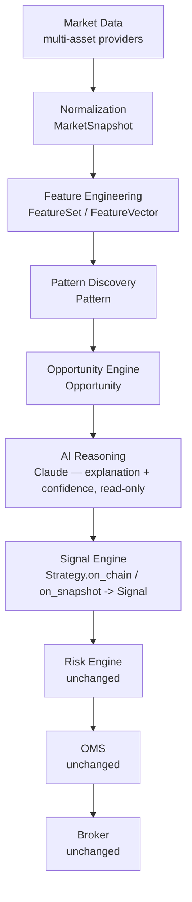

# Ceremyn — Architecture Roadmap v2: Toward a Market Intelligence Platform

> Phase 1 deliverable: architectural review only. **No production code changes accompany
> this document.** Every claim below about the current codebase was verified against
> the actual source in this repository (file paths and behavior cited throughout), not
> assumed from the platform's name or its milestone history.

---

## 1. Executive summary

Ceremyn's rebrand from an options-trading system to an "AI-powered Market Intelligence
Platform" is more achievable than it might sound, because a large share of the
groundwork already exists — just not yet assembled into a market-intelligence *pipeline*.
Concretely, already in place today:

- **`Instrument`/`AssetClass`** (`domain/instruments.py`) already generalize the
  execution-side domain model across options, equities, futures, and ETFs (landed in the
  M16 multi-asset migration).
- **`Signal`/`SignalLeg`** (`domain/signals.py`) are already asset-class-neutral and
  already independent of any specific `Strategy` object — a `Signal` carries only a
  `strategy_id: str`, not a strategy reference.
- **`FeatureSet`/`FeatureEngine`** (`features/models.py`, `features/engine.py`) already
  implement exactly what "feature engineering" needs: versioned, cached, validated,
  reproducible feature bundles keyed by context.
- **`OrderManagementEngine.submit_signal`**, the **`RiskEngine`**, and the broker layer
  are already asset-agnostic (verified: none of them import or branch on
  `OptionContract` specifically) and are the single choke point every order passes
  through, exactly as CLAUDE.md's safety invariants require.

What's genuinely missing, verified against the code, is narrower than the long-term
vision implies:

1. **The strategy-observation surface is still options-and-chain-only.**
   `StrategyContext.chain: OptionChainSnapshot` (`strategies/base.py`) is a *required*
   field, and `OptionChainSnapshot` (`domain/chain.py`) structurally cannot represent a
   non-option observation (`expiry: date` is required, `entries` requires at least one
   `OptionContract`-typed `ChainEntry`). This is the true bottleneck behind "is
   `OptionChainSnapshot` still the correct center" — see §3.3.
2. **The LLM has zero role in discovery.** Every one of its tools (`llm/tools.py`) reads
   *already-computed* dashboard/experiment/recap state. It explains what happened; it
   never looks at raw market data and never proposes anything. "AI Reasoning" as a
   pipeline stage does not exist yet in any form.
3. **There is no live, cross-underlying ranking concept.** The Research Lab
   (`research/experiment.py` and friends) is a retrospective, offline backtesting/sweep
   tool. There is no "Opportunity," "Pattern," or live-ranking object anywhere in the
   domain model today.

The recommended path (§6) is therefore **not** a rewrite of the execution spine. It is:
generalize the observation surface additively (`MarketSnapshot`, composing — not
replacing — `OptionChainSnapshot`), introduce `Pattern`/`Opportunity` as new read-only
domain types fed by data the platform already computes, and give the LLM a genuinely new
(but still strictly read-only, still import-linter-barred from execution/risk) job:
explaining those opportunities. Signal production, risk validation, and order management
do not change at all in Phase 1–5 of this roadmap.

---

## 2. Current architecture (verified)

```
Kite / NSE bhavcopy (data/providers/)
        │
        ▼
ChainService (data/services/snapshots.py) ── builds OptionChainSnapshot
        │
        ▼
StrategyContext(chain=..., positions=..., portfolio=..., iv_rank=...)
        │
        ▼
Strategy.on_chain(ctx) -> list[Signal]        (strategies/base.py; 15 registered types)
        │
        ▼
OrderManagementEngine.submit_signal(signal)   (oms/engine.py — the one legal entry point)
        │
        ▼
RiskEngine.validate(...)                       (risk/engine.py — every order passes through this)
        │
        ▼
Router → GatedBrokerAdapter → SimulatedBroker / KiteBroker
```

Running in parallel, disconnected from the trading path:

```
OMS / Risk / Feature / Portfolio state
        │
        ▼
DashboardService (read-only views)
        │
        ▼
llm/tools.py (16 read-only tools over dashboard/experiment/recap state)
        │
        ▼
Claude — explains, summarizes, reviews. Never decides BUY/SELL.
(enforced structurally: llm cannot import execution or risk — import-linter contract)
```

Two things worth naming precisely, both already documented in `ARCHITECTURE_DECISIONS.md`
and directly relevant to any "scan every market" ambition:

- **Two parallel runtime drivers exist** — `RuntimeOrchestrator` (WebSocket-streaming
  shaped, currently wired with zero strategies) and `RestPricePoller` (REST-polling,
  hardcodes exactly 1 of the 15 registered strategies). Neither is a "scan N
  underlyings across M asset classes" engine today.
- **The Research Lab is retrospective.** `ExperimentSpec`/`Experiment`
  (`research/experiment.py`) exist to reproducibly backtest *known* strategy
  configurations, not to discover new ones live.

---

## 3. Architectural analysis

### 3.1 What is the true core domain, today vs. the vision?

**Today:** the option chain at an instant, and what a fixed-shape strategy does with it.
Every strategy, every backtest, every paper/live tick is organized around "one
underlying's option chain, right now."

**Vision:** a market observation — of whatever shape the asset class produces — the
features/patterns extracted from it, and the opportunities/signals that follow. Asset
class becomes a property of the observation, not the shape of the observation itself.

### 3.2 What should become the central domain model?

An asset-class-neutral **market observation** type (§3.4 names it `MarketSnapshot`),
sitting where `OptionChainSnapshot` sits today, but not requiring an option chain to
exist.

### 3.3 Is `OptionChainSnapshot` still the correct center?

**No — verified structurally, not just conceptually.** `OptionChainSnapshot.expiry` is a
required `date` field, and `entries: tuple[ChainEntry, ...]` requires `min_length=1` of
`OptionContract`-typed entries (`domain/chain.py:19,34,37`). There is no way to construct
one for an equity, a futures contract standing alone, a forex pair, or a crypto asset.
It cannot be the center of a multi-asset-class platform; it can only be *a* view.

### 3.4 If not, what replaces it?

Nothing replaces it — something is added **above** it. A new `MarketSnapshot` composes
an optional `OptionChainSnapshot` (present for optionable underlyings) alongside a
generic quote/candle (present for everything). `OptionChainSnapshot` keeps its exact
current shape and all its current call sites unchanged.

### 3.5 Should `Asset` exist?

Only once something needs asset-level metadata that doesn't belong on `Instrument` —
e.g. sector, market cap, a stable identity across an equity/its options/its futures.
Today, `Instrument.underlying: str` already does ~90% of this job as a string key.
**Recommendation: not yet.** Introducing `Asset` now would be building for a
hypothetical need (see §9). Revisit when a concrete feature (e.g. sector-level
aggregation) needs it.

### 3.6 Should `Instrument` exist?

It already does (`domain/instruments.py`, landed in M16) and is already the right level
of abstraction — every consumer (`Position`, `Order`, `SignalLeg`, the backtest ledger)
already speaks it. No further action needed.

### 3.7 Should `MarketSnapshot` exist?

**Yes — this is the single highest-leverage new domain type in this roadmap.** See §3.4
and §5.1.

### 3.8 Should `Opportunity` exist?

Yes, but kept sharply distinct from `Signal`:

- A **`Signal`** is a strategy's *executable* intent — it must resolve to concrete legs,
  quantities, and a side, and it is only ever produced by a versioned, backtestable
  `Strategy`.
- An **`Opportunity`** is a market condition worth a human's or the LLM's attention —
  carrying a rationale, an expected-edge estimate, and a confidence — with **no
  obligation to ever become a Signal.** Most opportunities, especially early on, will
  just be surfaced and explained, never traded.

### 3.9 Should `FeatureVector` exist?

**It effectively already does.** `FeatureSet` (`features/models.py`) is exactly this: an
immutable, versioned, keyed bundle of named feature values for one context, computed
by `FeatureEngine` with caching and validation already built in. Recommend using
"feature vector" as the market-intelligence-facing name for the same object rather than
rebuilding it.

### 3.10 Should `Signal` become independent from `Strategy`?

**At the domain level, it already is.** `Signal.strategy_id` is a plain string, not an
object reference (`domain/signals.py:46`), and the OMS never imports `strategies` at all
(import-linter contract: "OMS cannot import strategies"). The real coupling is at the
*producer* level: today, the only code that can legally construct-and-submit a `Signal`
is a `Strategy.on_chain()` call inside a runner. The fix is not a domain-model change —
it's a future runtime decision about whether something other than a `Strategy` subclass
(e.g. an opportunity-driven strategy variant) is allowed to call `submit_signal`, while
still going through the same deterministic, versioned, backtestable code path.

### 3.11 Which modules should remain exactly as they are?

`domain/orders.py`, `domain/positions.py`, all of `oms/*`, all of `risk/*`,
`execution/*`, `broker/*`. This is the safety-critical, already asset-agnostic execution
spine. CLAUDE.md's invariants apply here unchanged no matter how many asset classes or
intelligence layers get added upstream of it.

### 3.12 Which modules should evolve?

`domain/chain.py` (gains `MarketSnapshot` alongside, doesn't lose anything),
`strategies/base.py` (`StrategyContext` gains an optional richer observation),
`features/*` (feature functions eventually need to accept non-chain contexts),
`llm/tools.py` plus a new intelligence-facing module (the "AI Reasoning" stage),
`runtime/*` (two drivers should eventually become one canonical driver — a pre-existing
open question, see `ARCHITECTURE_DECISIONS.md` §2, made more urgent by this vision, not
created by it), `data/providers/*` (already being widened since M17; forex/crypto
providers don't exist yet).

### 3.13 Which modules should eventually disappear?

Nothing in the safety/execution spine. The realistic candidate is **one of the two
runtime drivers** (`RuntimeOrchestrator` vs. `RestPricePoller`) once a target driver is
chosen — not because of this rebrand, but because a platform that scans multiple asset
classes continuously needs one canonical live-data driver, not two competing shapes.
This decision already existed before this roadmap (`ARCHITECTURE_DECISIONS.md` §2); this
roadmap just raises its priority.

---

## 4. Domain model (target state)

| Object | Status | Notes |
|---|---|---|
| `Market` | Not needed as a type | `Exchange` + `AssetClass` already cover "where/what kind" — a `Market` object would just wrap two enums that already exist. |
| `Exchange` | **Exists** (`domain/enums.py`) | Keep as-is. |
| `Asset` | Deferred | See §3.5 — build only when a concrete need for asset-level (not instrument-level) metadata appears. |
| `Instrument` | **Exists** (`domain/instruments.py`) | Keep as-is — already the right abstraction. |
| `MarketSnapshot` | **New — Phase 1 priority** | Asset-class-neutral point-in-time observation. Composes optional `option_chain: OptionChainSnapshot \| None` and `candle: Candle \| None`. Additive: nothing existing depends on it until strategies opt in (§6, Phase 3). |
| `FeatureVector` | **Exists as `FeatureSet`** | No rebuild — see §3.9. |
| `Pattern` | **New** | A detected, named, explainable structural condition (e.g. "IV-rank extreme," "PCR divergence") evidenced by a `FeatureSet`/`MarketSnapshot`. Purely descriptive: no expected edge, no action. |
| `Opportunity` | **New** | A `Pattern` (or set of patterns) plus a rationale, an expected-edge estimate, and a confidence. See §3.8. No obligation to become a `Signal`. |
| `Signal` | **Exists** (`domain/signals.py`) | Keep as-is — already asset-agnostic, already `Strategy`-independent at the domain level (§3.10). |
| `Position` | **Exists** (`domain/positions.py`) | Keep as-is. |
| `Portfolio` | **Exists** (`domain/portfolio.py`: `PortfolioSnapshot`/`PortfolioExposure`/`PortfolioGreeks`) | Keep as-is. `PortfolioGreeks` stays an optional attachment for option-heavy portfolios, mirroring how `OptionChainSnapshot` becomes an optional attachment on `MarketSnapshot` — same pattern, applied consistently. |
| `RiskProfile` | **Not recommended yet** | Today's `RiskEngine` is configured once, from static settings, for a single operator. A `RiskProfile` object implies multiple concurrent risk postures (multi-user/multi-strategy), which is not a stated requirement. Building it now would be speculative (see §9). |
| `ExecutionIntent` | **Not recommended — redundant** | `Signal`'s own docstring already states "a strategy's intent." Introducing a second "intent" type between `Signal` and `Order` duplicates a concept the domain already has a name for. This is a place to disagree with the example list rather than follow it literally. |

---

## 5. Future architecture

### 5.1 Proposed flow



This mostly matches the long-term vision's own example ordering, with one deliberate
refinement to the **AI Reasoning → Signal Engine** boundary, made explicit because it is
exactly where a safety invariant lives:

> **The AI Reasoning stage may only feed *information* into the Signal Engine's
> deterministic strategies — it must never author a `Signal` directly, even indirectly
> via a "just this once" carve-out.** Every `Signal` must remain traceable to a
> versioned, backtestable `Strategy`, even one whose job becomes "watch for AI-flagged
> Opportunities meeting rule X" rather than "watch raw chain data." This is CLAUDE.md
> invariant #3 ("the LLM never decides BUY or SELL"), restated for the new pipeline
> rather than relaxed by it. Concretely: extend the import-linter contract set so any new
> `intelligence`/`opportunity` package is barred from `execution` and `risk` exactly like
> `llm` is today.

Everything from **Risk Engine** onward is the existing spine (§2), completely unchanged.

---

## 6. Migration roadmap

Every phase below compiles independently, preserves existing behavior for all 15
registered strategies and all 3 runners byte-for-byte, and passes the existing test
suite unmodified — new tests are added only for new, additive types.

| Phase | Scope | Touches execution/risk/OMS? | Effort | Risk |
|---|---|---|---|---|
| **1** (this document) | Rebrand + positioning + this architectural review | No | Done | None |
| **2** ✅ | Add `MarketSnapshot` to a new `domain/snapshot.py`: `underlying`, `timestamp`, `quote: Quote \| None`, `candle: Candle \| None`, `option_chain: OptionChainSnapshot \| None`. Nothing consumes it yet. **Landed** (`feat(domain): introduce MarketSnapshot abstraction`). | No | S | None — purely additive, unused type |
| **3** | `StrategyContext` gains an optional `snapshot: MarketSnapshot \| None` field alongside the existing required `chain`. `chain` stays required — zero behavior change for the 15 existing strategies. | No | M | Low — additive field only |
| **4** ✅ (equities + commodities, script-only) | Introduce `Pattern` + `Opportunity` domain types and detectors: **landed** as candlestick pattern detection (`patterns/candlestick.py`, ~61 TA-Lib recognizers), a historical hit-rate/forward-return study (`patterns/study.py`), and a cross-symbol ranking layer (`patterns/opportunity.py`) that surfaces only live (latest-bar) occurrences clearing a minimum-evidence bar, ranked by expected edge. Runs today against **equities** (NSE bhavcopy, free) and **commodities** (MCX futures via `CommodityContract`/`fetch_commodity_contracts`, using the operator's own Kite account). Demo: `scripts/find_opportunities.py --equities ... --commodities ...`. **Known gap**: commodity contract *discovery* works against real MCX data, but live quote/historical-candle fetching currently fails for this Kite account/app (MCX segment likely not enabled for market-data API access, separate from instrument-list access) — an account entitlement to resolve with Zerodha, not a code issue. **Not yet done**: the read-only `/intelligence` API endpoint and a dashboard panel — still script-only. A separate, human-in-the-loop `POST /trading/equity` (see git history around `feat(api): manual equity trade submission`) now lets someone submit a specific order through the real risk/OMS pipeline, but nothing connects it to an `Opportunity` automatically — a human still chooses the symbol/quantity/price every time; the "no path to execution" guarantee below is about `Opportunity`/`Pattern` themselves, not about whether the platform can trade equities at all. | No | M–L | Low — net-new, read-only, no path to execution (4 new import-linter contracts added) |
| **5** | Extend `llm/tools.py` with new read-only tools (`get_patterns`, `get_opportunities`). Same import-linter contract shape as today's 16 tools — still barred from `execution`/`risk`. | No | S | None — same contract as today |
| **6** | (Needs its own design review before scoping specifics.) Generalize `Strategy`/`StrategyContext` so a strategy can legally watch `Opportunity`/`Pattern` streams instead of only raw `OptionChainSnapshot`, still producing the same `Signal` type through the same deterministic, versioned, backtestable code path. | Touches the strategy/signal boundary only — `Signal`'s shape and the risk/OMS spine do not change | L | Medium — first phase that changes a load-bearing interface (`StrategyContext`/`Strategy.on_chain`) |
| **7+** | Additional asset-class data providers (forex/crypto), additional detectors, multi-underlying/multi-asset-class opportunity ranking. | No (unless a new asset class needs new risk rules — separate review) | Ongoing | Depends on scope at the time |

---

## 7. Risks

- **Scope creep.** "Market Intelligence Platform" framing invites building a general
  ML/research platform. Resist building speculative pattern-mining infrastructure before
  Phase 4's two rule-based detectors prove the concept is worth the dashboard/LLM
  real estate.
- **Safety-invariant erosion.** Any design that lets an LLM call construct or approve a
  `Signal` directly — even as a "just this once" exception — breaks CLAUDE.md invariant
  #3. Guard this with import-linter contracts on every new package, the same way `llm`
  is barred from `execution`/`risk` today (§5.1).
- **Compounding the two-runtime-driver question.** Adding a market-wide scanning
  workload on top of the already-ambiguous `RuntimeOrchestrator`/`RestPricePoller` split
  (`ARCHITECTURE_DECISIONS.md` §2) compounds an existing unresolved question. Resolve
  that decision before Phase 6, not after.
- **Data-cost reality.** "Scan every market continuously" across equities, options,
  futures, forex, and crypto implies real-time data costs. Today's bhavcopy data is free
  EOD; NIFTY/BANKNIFTY live data is one Kite subscription. Multi-asset continuous
  scanning is a commercial/vendor decision, not purely an engineering one — flag it
  explicitly rather than assume it scales for free.
- **Testing burden.** Every new `Pattern`/`Opportunity` detector needs the same
  backtest-grade reproducibility rigor as a `Strategy`, or it undermines the platform's
  own "not a black-box" positioning promise from the README rewrite in this same session.

---

## 8. Recommended first implementation

**Phase 2 + the first two Phase 4 detectors, as a single, fully reversible slice:** add
the (unused) `MarketSnapshot` type, then a small `intelligence/` package containing
`Pattern` and one detector each for "IV-rank extreme" and "PCR divergence" — both
re-labelings of `FeatureSet` values the platform already computes today — surfaced via
one new read-only dashboard panel and one new LLM tool. This proves the entire
"discover → explain" narrative end-to-end without touching strategies, risk, or OMS at
all, and can be deleted with zero blast radius if it doesn't prove valuable.

---

## 9. Things to avoid

- Do not replace `OptionChainSnapshot` — compose around it (§3.4).
- Do not let `Opportunity`/`Pattern` gain any code path into `OMS.submit_signal` — only
  a `Signal`, produced by a versioned `Strategy`, may reach the OMS.
- Do not build `Asset` or `RiskProfile` speculatively before a concrete requirement
  forces them (§3.5, §4).
- Do not introduce `ExecutionIntent` — redundant with the existing `Signal` (§4).
- Do not attempt multi-asset-class continuous scanning before the runtime-driver
  question (`ARCHITECTURE_DECISIONS.md` §2) is resolved — that would be scaling an
  already-ambiguous architecture rather than a settled one.
- Do not let this rebrand's positioning language leak into the safety invariants
  themselves. CLAUDE.md's safety section is unchanged and must stay unchanged in
  substance regardless of how the product is marketed.

---

## 10. Technical debt (carried forward)

The four deferred questions already recorded in `ARCHITECTURE_DECISIONS.md` all become
*more* relevant once "scan continuously across every market" is a stated direction,
since each is really an instance of "which driver actually runs in production":

1. `PaperTradingEngine`'s fate (constructed with zero strategies, only read by two
   LLM-recap call sites).
2. The `RuntimeOrchestrator`/`RestPricePoller` split, including the load-bearing shared
   `oms_engine` maintenance loop.
3. `ChainSnapshotJob` never being scheduled.
4. Only 1 of 15 registered strategies being live/paper-selectable.

None of these are created by this roadmap; all of them are worth resolving earlier
rather than later given the direction this roadmap describes.

---

## 11. Success metrics

- **Precision over recall, early.** For Phase 4's read-only intelligence layer: what
  fraction of surfaced Patterns/Opportunities would a domain expert agree are real,
  not a rate of "opportunities found per day."
- **Zero regressions.** The full existing test suite (1,063 unit tests as of the
  `refactor: rename AlphaQuant to Ceremyn` commit) stays green after every phase.
- **Import-linter contracts only grow, never shrink.** Every new package added under
  this roadmap gets its own forbidden-import contract where relevant (matching `llm`'s
  today); none of the existing 17 contracts are weakened or removed.
- **Qualitative adoption, not a vanity count.** Does an Opportunity's LLM-generated
  explanation actually change what a human researcher investigates next (checked via
  the existing dashboard/LLM chat), rather than counting how many opportunities were
  surfaced.
